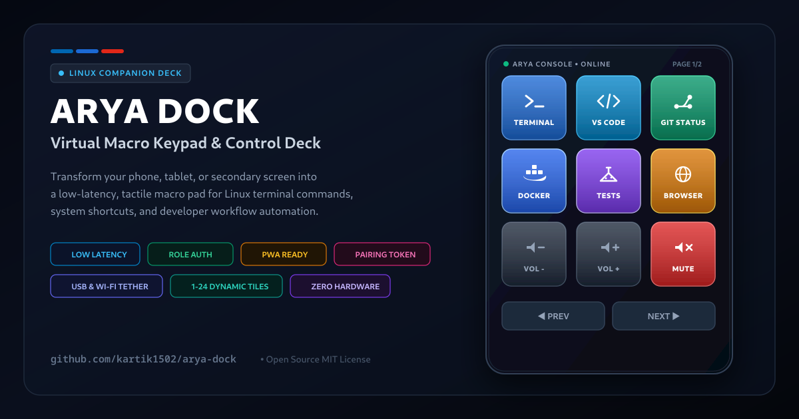

# 🏁 Arya Dock — Virtual Macro Keypad & Stream Deck Alternative for Linux

[](https://github.com/kartik1502/arya-dock/actions/workflows/ci.yml)
[](https://github.com/kartik1502/arya-dock/actions/workflows/security.yml)
[](https://opensource.org/licenses/MIT)
[](https://nodejs.org/)
[](public/manifest.json)

> **Arya Dock** is a high-performance, dark-cockpit virtual macro keypad and stream deck alternative for Linux. Transform your smartphone, tablet, or secondary display into a customizable, low-latency companion deck for developer workflows, terminal scripts, system hotkeys, and media controls — completely free and hardware-independent.

<p align="center">
  
</p>

---

## 📑 Table of Contents

- [🏎️ What is Arya Dock?](#what-is-arya-dock)
- [✨ Key Features](#key-features)
- [🛠️ Supported Platforms & Requirements](#supported-platforms--requirements)
- [⚡ Connection Modes](#connection-modes)
  - [Option A: USB Cable (Lowest Latency)](#option-a-usb-cable-recommended-for-lowest-latency)
  - [Option B: Wi-Fi / LAN](#option-b-wi-fi--lan)
- [🚀 Getting Started](#getting-started)
  - [1. Prerequisites](#1-prerequisites)
  - [2. Installation](#2-installation)
  - [3. Run Verification Tests](#3-run-verification-tests)
  - [4. Start the Service](#4-start-the-service)
  - [5. Startup Banner Output](#5-startup-banner-output)
- [📚 Documentation Guides](#documentation-guides)
- [📁 Repository Structure](#repository-structure)
- [🤝 Contributing](#contributing)
- [🛡️ Security](#security)
- [📄 License](#license)

---

<a id="what-is-arya-dock"></a>
## 🏎️ What is Arya Dock?

**Arya Dock** is a web-based companion deck and virtual stream deck alternative that eliminates the need for expensive physical macro keypads or proprietary hardware consoles. It runs as a local web service on your Linux workstation and streams an interactive, responsive control deck to any connected device (mobile browser, tablet, or desktop window).

Whether you are writing code, monitoring cloud infrastructure, compiling microservices, running tests, or controlling media playback, Arya Dock gives you instant physical command over your workstation directly from your desk phone stand.

---

<a id="key-features"></a>
## ✨ Key Features

- 📱 **Hardware-Free Companion Deck:** Turn any phone or tablet into a tactile macro keypad via modern Progressive Web App (PWA) technology.
- ⚡ **Ultra Low-Latency Execution:** USB tethering connection mode ensures near-zero latency input dispatch to your system.
- 🔒 **Defense-in-Depth Security:** Cryptographically generated pairing tokens, constant-time authentication, and Origin verification protect your workstation.
- 📐 **Dynamic Responsive Bezel:** Container-query-based adaptive layout scales dynamically from 1 to 24 keys without text truncation.
- 🚀 **Native Linux Integration:** Direct execution in your preferred shell (Bash, Zsh) and terminal emulator (`ptyxis`, `gnome-terminal`, `konsole`, `alacritty`, `kitty`).
- 🎵 **Workstation & Media Controls:** Native hotkeys for volume adjustment, mute toggles, and media track playback.

---

<a id="supported-platforms--requirements"></a>
## 🛠️ Supported Platforms & Requirements

* **Operating System:** Linux (systemd-based distributions such as Fedora, Ubuntu, Arch, Debian)
* **Runtime:** Node.js v18.0.0 or higher
* **Default Shells:** Zsh (`/usr/bin/zsh`) or Bash (`/bin/bash`)
* **Terminal Emulators (auto-detected):** Ptyxis, GNOME Terminal, Konsole, Alacritty, Kitty, Xfce Terminal, xterm
* **System Utilities (modular platform adapters):**
  - Media player control & volume via PipeWire/WirePlumber or PulseAudio
  - Desktop URL and file manager dispatching

---

<a id="connection-modes"></a>
## ⚡ Connection Modes

```text
 📱 Phone / Tablet (PWA or Browser)
       │
       ├── [OPTION A: USB Cable] ────────► Low-latency via USB Tethering
       │                                         │
       └── [OPTION B: Wi-Fi / LAN] ──────► Instant LAN connection via QR Code
                                                 │
                                                 ▼
                                    🖥️ Workstation (server.js :3333)
                                        ├─ Auth & Origin Guard (lib/auth.js)
                                        ├─ Atomic Config Manager (lib/config.js)
                                        ├─ Terminal Dispatcher (lib/terminal.js)
                                        └─ FreeDesktop App Parser (lib/apps.js)
```

<a id="option-a-usb-cable-recommended-for-lowest-latency"></a>
### Option A: USB Cable (Recommended for Lowest Latency)
1. Connect your phone to your PC using a USB cable.
2. Turn on **USB Tethering** in your phone's network settings.
3. The server terminal detects the USB interface and prints the paired USB link (e.g. `http://10.91.187.251:3333/?token=...`).
4. Open the URL in your phone browser for instant, jitter-free physical response.

<a id="option-b-wi-fi--lan"></a>
### Option B: Wi-Fi / LAN
1. Ensure your phone and PC are connected to the same Wi-Fi network.
2. Scan the **QR Code** generated in your terminal at server startup.

---

<a id="getting-started"></a>
## 🚀 Getting Started

<a id="1-prerequisites"></a>
### 1. Prerequisites
- Linux workstation with Node.js >= 18.0.0 installed.
- Modern browser on your phone/tablet (Chrome, Firefox, Safari).

<a id="2-installation"></a>
### 2. Installation
```bash
# Clone the repository
git clone https://github.com/kartik1502/arya-dock.git
cd arya-dock

# Install dependencies
npm install
```

<a id="3-run-verification-tests"></a>
### 3. Run Verification Tests
```bash
# Run full unit and integration test suite
npm test
```

<a id="4-start-the-service"></a>
### 4. Start the Service
```bash
# Start Arya Dock
npm start
```

<a id="5-startup-banner-output"></a>
### 5. Startup Banner Output
```text
========================================================
         🚀 ARYA DOCK — VIRTUAL KEYPAD CONSOLE          
========================================================

  🖥️  PC Web App:            http://localhost:3333/?token=...
  🐚  System Shell:          /usr/bin/zsh (zsh)
  ⚡  Terminal Emulator:     /usr/bin/ptyxis (ptyxis)
  🔌  USB Cable Tethering:   http://10.91.187.251:3333/?token=...
  📱  Wi-Fi (wlo1):          http://192.168.1.24:3333/?token=...

--- SECURITY & ROLES ---
• Pairing Token:   <random_32_char_hex>
• Editor Key:      <random_32_char_hex>
• Role Privileges: Localhost sessions have editor privileges. Remote sessions connect as operators.
                   To unlock editing remotely, use the in-app unlock modal or pass the X-Editor-Key header.
```

---

<a id="documentation-guides"></a>
## 📚 Documentation Guides

For in-depth architecture, configuration, and customization guides, see the dedicated documentation:

* 🔒 **[Security Model & Architecture Guide](docs/security-model.md)**: Pairing tokens, Origin header verification, Operator vs. Editor role separation, localhost proxy caveats, credential rotation lifecycle, and Content Security Policy.
* ⚙️ **[Configuration & Environment Reference](docs/configuration.md)**: Complete reference of all environment variables (`HOST`, `PORT`, `CONFIG_PATH`, `AUTH_PATH`, `TERMINAL`, `ARYA_*`), CLI flags (`--rotate-credentials`, `--start`), and custom config paths.
* 🎛️ **[Usage & Deck Customization Guide](docs/usage-guide.md)**: Navigation modes (M1 Dev, M2 Media), dynamic tile count adjustments (`+`/`−`), drag & drop application catalog, terminal execution modes, multi-client synchronization, and data-loss protection.
* 🎨 **[Motorsport Cockpit Design System](DESIGN.md)**: Design philosophy, pitch-black OLED canvas, container queries, and cockpit ergonomics.
* 🔌 **[Protocol Specifications](docs/protocol-specs.md)**: WebSocket message types, JSON payloads, and network framing.
* 🔭 **[Active Window Detection Spike](docs/active-window-spike.md)**: Investigation findings for desktop window focus tracking on GNOME Wayland and X11.

---

<a id="repository-structure"></a>
## 📁 Repository Structure

```text
arya-dock/
├── config/                   # Default templates and local configuration
├── docs/                     # In-depth architectural and configuration guides
│   ├── configuration.md      # Environment variables and CLI reference
│   ├── security-model.md     # Security architecture, roles, and rotation
│   ├── usage-guide.md        # Deck operation and tile customization
│   ├── protocol-specs.md     # Reference protocol specification
│   └── active-window-spike.md # Active window detection spike analysis
├── lib/                      # Core backend services (auth, config, terminal, apps, ws, http)
├── platform/                 # Modular OS abstraction layer (Linux, Darwin, Fake)
├── public/                   # Frontend PWA (HTML, CSS, JS, manifest, Service Worker)
├── scripts/                  # Utility scripts (lint.js)
├── test/                     # Comprehensive test suites (unit, integration, platform, security)
├── server.js                 # Server entry point
└── package.json              # Project manifest and scripts
```

---

<a id="contributing"></a>
## 🤝 Contributing

Contributions, bug reports, and enhancements are warmly welcomed! Please read our [Contributing Guidelines](CONTRIBUTING.md) and [Code of Conduct](CODE_OF_CONDUCT.md) before submitting pull requests.

---

<a id="security"></a>
## 🛡️ Security

To report security vulnerabilities responsibly, please consult our [Security Policy](SECURITY.md).

---

<a id="license"></a>
## 📄 License

This project is open-source under the [MIT License](LICENSE). Created by [Karthik Kulkarni](https://github.com/kartik1502).
