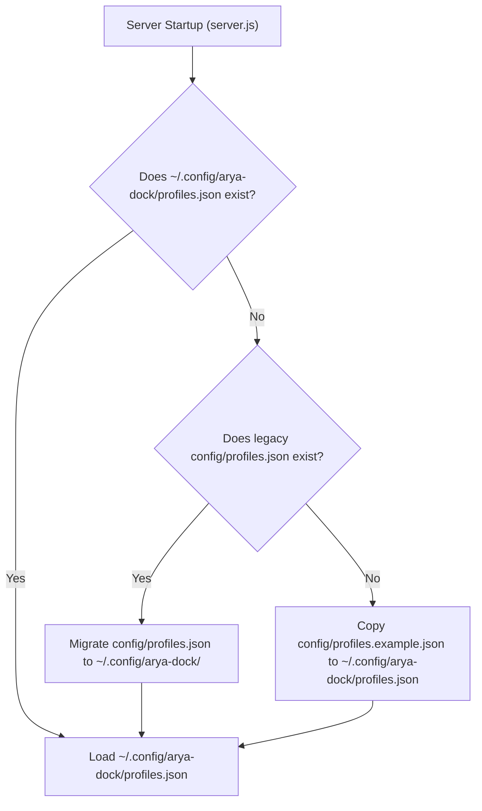

# ⚙️ `config/` — Configuration Templates & Storage Boundary

The `config/` directory contains default seed configuration templates and fallback files for Arya Dock.

---

## 📑 File Manifest

| File | Role | Description |
|---|---|---|
| [`profiles.example.json`](file:///home/karthikulkarni/Documents/arya-dock/config/profiles.example.json) | Canonical Template (Schema v2) | Read-only reference configuration containing preconfigured `developer` and `media` workspaces, AI agent templates, system monitoring shortcuts, and media controls. Used to seed new installations. |
| [`profiles.json`](file:///home/karthikulkarni/Documents/arya-dock/config/profiles.json) | Fallback / Legacy Config | Local repository configuration file. Migrated automatically to `~/.config/arya-dock/profiles.json` on first boot. Serves as a fallback if the user home directory is read-only. |

---

## 🏛️ Storage Boundary & XDG Resolution

Arya Dock deliberately stores runtime user configuration **outside the git repository** in compliance with the **XDG Base Directory Specification**:

```text
Default Storage Locations:
  • Linux/Unix: ~/.config/arya-dock/profiles.json
  • Credentials: ~/.config/arya-dock/auth.json (strict 0600 permissions)
```

### Why Config Lives Outside the Repository
1. **Pristine Git Status**: Customizing tiles, reordering buttons, or adding personal commands does not dirty `git status` or trigger merge conflicts on pull.
2. **Privacy & Security**: Prevents personal file paths, project directories, and custom command strings from being accidentally committed to public repositories.

---

## 🔄 First-Boot Migration & Seeding Lifecycle



---

## 📐 Schema Version 2 Specification

Configuration files conform to `schemaVersion: 2`:

```json
{
  "schemaVersion": 2,
  "activeWorkspaceId": "developer",
  "activeProfile": "developer",
  "workspaces": [
    {
      "id": "developer",
      "name": "Developer & AI Workflows",
      "icon": "💻",
      "origin": "user",
      "match": {
        "apps": ["code", "ptyxis", "alacritty", "kitty"]
      },
      "pages": [
        {
          "pageNumber": 1,
          "name": "AI & Core Tools",
          "buttons": [
            {
              "id": 0,
              "label": "AI AGENT",
              "sublabel": "WORKSPACE",
              "icon": "🤖",
              "color": "#6366f1",
              "actionType": "shell",
              "command": "echo 'AI Agent'",
              "terminalMode": "tab",
              "workingDir": "~/Projects",
              "keepOpen": true,
              "url": ""
            }
          ]
        }
      ]
    }
  ],
  "profiles": {
    "developer": { "...": "Backwards-compatible mirror maintained by saveConfigAtomic" }
  }
}
```

---

## 🧪 Verification & Testing

```bash
# Verify schema migrations (v0 -> v1 -> v2), atomic saves, and auto-recovery
node --test test/config.test.js
```
