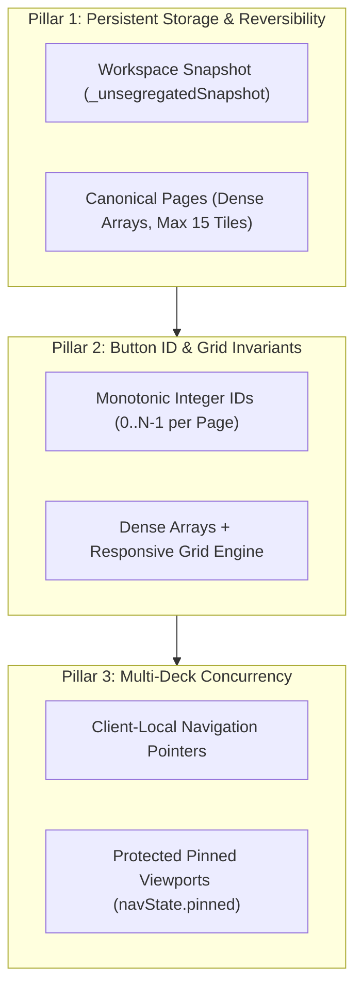

# Stage 8: Intermediate Zoom Out Review Report

Target Document: `docs/designs/workspace-tile-segregation.md`  
Reviewer: Skeptical Architect (`egm-zoom-out`)  
Scope: Full Document (Lines 1 to 384)  

---

## 1. Executive Architectural Synthesis: Storage Mutation vs. View Projection

The central premise of the Workspace Tile Segregation Engine is to eliminate visual clutter and context-switching friction on hardware companion decks by grouping workstation shortcuts into four functional categories (**Terminal**, **Application**, **URL**, **Media**) while enforcing a strict **15-tile (5×3 grid) capacity limit** per page.

However, the intermediate design attempts to solve what is fundamentally a **presentation and navigation concern** by **physically mutating the underlying persistence layer**. It shreds the canonical `workspace.pages` array on disk into separate category pages, dynamically reallocating buttons, creating overflow sub-pages, pruning empty sub-pages, and attempting two-way coordinate tracking (`originCoordinates`) for reversibility.

### The High-Altitude Trade-Off Analysis

| Architectural Dimension | Current Proposal: Server-Side Physical Segregation | Simpler Alternative: Non-Destructive Virtual Lens / Jumper |
|---|---|---|
| **Data Model Blast Radius** | **High & Destructive**: Rewrites `workspace.pages` on disk; moves buttons across page boundaries; alters array indices. | **Zero**: Leaves `workspace.pages` completely untouched in storage. |
| **Reversibility Complexity** | **Brittle O(N) Distributed Ledger**: Requires `originCoordinates` tracking, synthetic coordinate generation for dynamic buttons, and multi-pass restoration. | **Instant O(1) Projection Toggle**: Toggling segregation off simply exits the filtered view. 100% mathematically lossless. |
| **Failure Modes** | **Data Loss & Server Crashes**: Unhandled `TypeError` on missing coordinates, duplicate button ID collisions, persistent disk corruption. | **Fail-Safe**: If client filter logic fails, backend configuration remains pristine. |
| **Multi-Deck Concurrency** | **Severe Hijacking Hazard**: Broadcasting global `navState.pageIndex` on tile edits abruptly shifts pages on physical companion decks under operators' fingers. | **Isolated Viewports**: Deck navigation remains independent; category jumps can be local to the requesting client or explicitly locked. |
| **Dynamic Responsive Grid** | **Degraded Ergonomics**: Sparse 15-cell grid (`slotIndex`) collapses responsive scaling (`getOptimalGridDimensions`), breaking finger targets on mobile screens. | **Fully Preserved**: Filtered arrays remain dense, allowing 2×1, 2×2, 3×3, and 5×3 dynamic scaling to maximize touch target size. |

### Skeptical Architect Verdict: Is Server-Side Segregation Justifiable?

**No, not in its current state.** Forcing physical disk mutation to achieve categorized views introduces massive accidental complexity:
1. It attempts to simulate a relational projection engine inside a static JSON configuration file.
2. It breaks Arya Dock's existing core invariants (monotonic integer button IDs, dense responsive touch grids, client-safe atomic state broadcasts).
3. It creates an unhandled algorithmic crash when restoring workspaces modified while segregated.

**Recommended Architectural Direction:**
The design document should either:
- **Path A (Architecturally Superior — Anti-YAGNI):** Pivot to a **Non-Destructive Virtual Lens / Category Jumper**. The server stores buttons canonically within the workspace; the presentation layer (or a lightweight server-side virtual view projection) partitions tiles dynamically into category views of up to 15 tiles on-the-fly. Reversibility becomes trivial, button IDs never collide, and disk corruption is impossible.
- **Path B (Hardened Physical Segregation — If Disk Persistence is Mandated):** If the business requirement strictly demands that `profiles.json` physically contain dedicated category pages, the architecture must be radically simplified by replacing per-tile coordinate tracking with an atomic **Workspace Snapshot (`_unsegregatedSnapshot`)**, enforcing monotonic integer button IDs across pages, and removing global navigation hijacking.

---

## 2. Concrete Architectural Guidance for Resolving Core Blockers

To ensure Arya Dock maintains long-term codebase health, tactile safety, and the strict 15-tile 5×3 limit, the following four architectural pillars must be codified:

### 1. Resolving the Integer Button ID Schema Breakdown & Collisions
* **The Root Issue**: Section 4.2 specifies string button IDs (`"btn-docker-up"`), which violates `validateButton()` in `lib/config.js` (`typeof id === 'number' && Number.isInteger(id) && id >= 0`). Furthermore, button IDs in Arya Dock are currently scoped locally per page (`[0, 1, 2]`). When `migrateToSegregated()` pools buttons across pages into category pages, duplicate IDs (`0, 0, 1, 1`) are created, breaking `BUTTON_CLICK`, `UPDATE_BUTTON`, and `DELETE_BUTTON` in `lib/ws.js`.
* **Architectural Guidance**:
  1. **Strict Integer Enforcement**: Retain `id` strictly as a non-negative integer (`0..14`). Strip any string ID specifications from documentation examples.
  2. **Monotonic Re-indexing on All Partitioning Operations**: In `lib/segregation.js`, whenever buttons are routed, migrated, or restored across pages, they must be deterministically re-indexed (`button.id = index`) within their target page array.
  3. **Preserve External Reference via Stable UUID**: If buttons require cross-page tracking for analytics or restoration, introduce an optional `uuid: string` field, but keep `id` as the runtime integer index dispatched over WebSockets.

### 2. Resolving the Reversibility Algorithmic Crash (Dynamic Tiles)
* **The Root Issue**: In Section 4.5, `migrateToSegregated()` records `originCoordinates` on existing buttons, but Section 4.4's `ADD_BUTTON` flow never populates `originCoordinates` for newly created buttons. When toggling segregation off, `restoreFromSegregated()` executes `button.originCoordinates.pageIndex`, throwing an unhandled `TypeError` that crashes the Node.js server.
* **Architectural Guidance**:
  - **Abandon Per-Tile Coordinate Ledgers**: Eliminate `button.originCoordinates` entirely. Managing distributed coordinate metadata across CRUD mutations is an anti-pattern.
  - **Adopt Workspace-Level Snapshotting + 2-Pass Restoration**:
    - **Toggle ON**: Clone the unsegregated pages array into `workspace._unsegregatedSnapshot = JSON.parse(JSON.stringify(workspace.pages))`.
    - **Toggle OFF**:
      - *Pass 1 (Base Restore)*: Restore `workspace.pages = workspace._unsegregatedSnapshot`.
      - *Pass 2 (Dynamic Merge)*: Identify any buttons created or modified during segregation (buttons present in category pages whose IDs or labels do not exist in the snapshot). Append these new buttons sequentially into existing pages that have `< 15` tiles, overflowing into `Page N+1` once existing pages reach capacity.
      - *Cleanup*: Delete `workspace._unsegregatedSnapshot` and persist to disk.

### 3. Resolving Multi-Deck Viewport Hijacking & Touch Concurrency
* **The Root Issue**: Sections 4.1, 4.4, and 4.6 specify broadcasting `navState.pageIndex` to all connected clients whenever a button is added or moved. In a workstation setup with an operator companion deck (tablet/phone) and a desktop browser editor, saving a button in the editor violently yanks the tablet's active page. An operator mid-tap risks hitting an unintended button, triggering accidental execution of shell commands.
* **Architectural Guidance**:
  1. **Decouple Mutation from Navigation Broadcasts**: Never alter or broadcast global `navState.pageIndex` during background tile CRUD mutations (`ADD_BUTTON`, `UPDATE_BUTTON`).
  2. **Client-Scoped Navigation Context**: Return the target page index solely to the originating WebSocket client that performed the edit (`client.send(...)`), allowing the editor UI to follow the tile without hijacking secondary companion decks.
  3. **Strict Deck Pin Protection**: If a companion deck is pinned (`navState.pinned === true`), the server must unconditionally reject remote page flips targeting that client.

### 4. Resolving Dynamic Responsive Grid vs. 15-Tile 5×3 Limit Conflict
* **The Root Issue**: Arya Dock's container query engine in `public/app.js` (`getOptimalGridDimensions()`) dynamically sizes buttons (e.g. 2×1 for 2 buttons, 2×2 for 4 buttons, 3×3 for 9 buttons) to maximize finger target size on mobile screens. The proposed sparse 15-cell grid with `slotIndex` gaps forces either a collapsed 2×1 layout that misplaces buttons, or requires padding the array with 13 dummy buttons, turning a 2-button page into tiny 40px squares on a phone screen.
* **Architectural Guidance**:
  1. **Maintain Dense Button Arrays**: Do not store empty placeholder objects in `page.buttons`. Keep arrays dense so `buttons.length` reflects actual interactive tiles.
  2. **Page Capacity Clamping**: Enforce the 15-tile limit strictly as an array length ceiling: `page.buttons.length <= 15`.
  3. **CSS-Only Slot Grid (If Spatial Whitespace is Desired)**: If `autoCompact: false` is active, implement visual whitespace purely in the CSS grid presentation layer (`grid-column` / `grid-row` attributes mapped from `slotIndex`), while keeping the underlying data model clean and unpadded.

---

## 3. Detailed Audit Findings Matrix

### 🔴 Blocker

#### 1. Architectural Over-Engineering: Physical Storage Mutation vs. Virtual Projection
* **Affected Scope**: Section 2 (Lines 27–34), Section 4.4 (Lines 200–238), Section 4.5 (Lines 240–262)
* **Simplicity Rationale (Contrarian / YAGNI)**:
  Mutating the physical JSON structure of `workspace.pages` on disk to achieve categorized navigation is an architectural misstep. It introduces massive data integrity risks (page overflow splits, sub-page pruning, coordinate reconciliation) to solve a problem that is fundamentally about UI navigation.
* **Concrete Resolution**:
  Refactor the core architecture to treat segregation as a **presentation-layer virtual lens**. Store all workspace buttons in their canonical order. When segregation is active, compute category-filtered pages of up to 15 buttons in memory. This eliminates 100% of the migration, overflow routing, sub-page pruning, and reversal code.

#### 2. Schema Invariant Violation & Cross-Page Integer Button ID Collisions
* **Affected Scope**: Section 4.2 (Line 123), Section 4.4 (Lines 205–215), Section 4.6 (Line 269)
* **Simplicity Rationale**:
  - Line 123 defines string IDs (`"btn-docker-up"`). `lib/config.js` strictly mandates non-negative integers (`typeof id === 'number' && Number.isInteger(id) && id >= 0`). Invalid string IDs are either rejected or forcefully overwritten with `0`.
  - Button IDs are currently scoped locally per page. Moving button `0` from Page 1 to Page 2 (which already contains button `0`) produces duplicate IDs, breaking WebSocket dispatching (`BUTTON_CLICK` finds the first matching button and triggers the wrong action).
* **Concrete Resolution**:
  Keep button IDs strictly as integers `0..14`. On every page migration, routing, or partitioning step, re-index `page.buttons` monotonically (`button.id = index`).

#### 3. Fatal Runtime Crash on Restoration (Missing Coordinates for Dynamically Added Buttons)
* **Affected Scope**: Section 4.4 (Lines 200–221), Section 4.5 (Lines 240–262)
* **Simplicity Rationale**:
  Section 4.5's reversal algorithm groups buttons by `button.originCoordinates.pageIndex`. However, Section 4.4 never populates `originCoordinates` when a button is created via `ADD_BUTTON` during segregated mode. Disabling segregation immediately throws:
  `TypeError: Cannot read properties of undefined (reading 'pageIndex')`
  This crashes the Node.js process and corrupts the workspace configuration.
* **Concrete Resolution**:
  Eliminate per-button `originCoordinates`. Implement a 2-pass restoration using a workspace-level snapshot (`workspace._unsegregatedSnapshot`), merging dynamically added buttons into available slots or subsequent pages.

#### 4. Multi-Deck Concurrency Hijacking via Global Navigation Broadcasts
* **Affected Scope**: Section 4.1 (Lines 84–85), Section 4.4 (Lines 220, 230), Section 6.3 (Line 384)
* **Simplicity Rationale**:
  Broadcasting `navState.pageIndex` to all connected clients whenever an editor creates or edits a tile violently flips the active page on connected secondary touch decks. This violates tactile safety: an operator about to tap a media control may inadvertently tap an incoming terminal command tile, executing destructive shell actions.
* **Concrete Resolution**:
  Do not update or broadcast global `navState.pageIndex` during button CRUD mutations. Keep navigation state client-scoped, and respect `navState.pinned === true` on companion decks.

#### 5. Dynamic Fluid Grid Engine Breakdown via Sparse `slotIndex`
* **Affected Scope**: Section 4.2 (Line 130), Section 4.4 (Line 205), Section 5.3 (Lines 291–297)
* **Simplicity Rationale**:
  Arya Dock uses dynamic grid scaling in `public/app.js` to adapt layout dimensions (1×1 up to 5×3) to `buttons.length`, maximizing touch ergonomics on mobile viewports. Imposing a rigid 15-cell grid with sparse `slotIndex` placeholders either breaks responsive scaling (rendering tiny buttons on phones) or causes layout collapsing where `slotIndex: 14` collapses into slot 0.
* **Concrete Resolution**:
  Enforce dense arrays in `page.buttons`. Keep `buttons.length <= 15` as the sole capacity invariant. Restrict visual slot positioning purely to CSS styling without injecting dummy objects into the backend data model.

---

### 🟡 Major

#### 6. Protocol Desynchronization & Unserialized Segregation State
* **Affected Scope**: Section 4.6 (Lines 264–273), Section 6.1 (Line 322), Section 6.2 Phase 2 (Line 356)
* **Simplicity Rationale**:
  The document invents new broadcast actions (`SET_WORKSPACE`, `NAV_STATE`). In Arya Dock, all state distribution is unified through `broadcastState()` emitting a single atomic `STATE_UPDATE` payload. Furthermore, `broadcastState()` currently does not serialize `workspace.segregation` or `page.category`, leaving client UIs unable to render segregation state.
* **Concrete Resolution**:
  Update `broadcastState()` in `lib/ws.js` to serialize `segregation: workspace.segregation || { enabled: false }` and `pageCategory: page.category || null` within the existing `STATE_UPDATE` action. Eliminate `SET_WORKSPACE` and `NAV_STATE` broadcast actions.

#### 7. Missing Privilege Checks (`ws.canEdit`) on Segregation Mutations
* **Affected Scope**: Section 4.6 (Lines 264–273), Section 6.2 Phase 2 (Lines 355–358)
* **Simplicity Rationale**:
  All mutating actions in `lib/ws.js` enforce role-based access control via `if (!ws.canEdit)`. The specification omits this check for `TOGGLE_SEGREGATION` and `SET_BUTTON_CATEGORY`, allowing unauthorized read-only companion clients to trigger destructive workspace reorganizations.
* **Concrete Resolution**:
  Mandate `if (!ws.canEdit)` authorization checks on `TOGGLE_SEGREGATION` and `SET_BUTTON_CATEGORY` handlers before processing mutations.

#### 8. Schema Whitelisting Stripping `workspace.segregation` & Missing `validatePage`
* **Affected Scope**: Section 4.2 (Lines 89–117), Section 6.1 (Line 320), Section 6.2 Phase 1 (Lines 334–337)
* **Simplicity Rationale**:
  `validateWorkspace()` in `lib/config.js` strictly whitelists properties and returns `{ id, name, icon, pages, origin, match }`, silently stripping `workspace.segregation`. Furthermore, `validatePage()` does not exist in the codebase (page validation is inline).
* **Concrete Resolution**:
  Update `validateWorkspace()` to whitelist `workspace.segregation`. Extract and export an explicit `validatePage(rawPage, options)` function in `lib/config.js` that validates `category` against `['terminal', 'application', 'url', 'media', null]`.

#### 9. Legacy Shortcut Misclassification & Desktop App Metadata Pipeline Gap
* **Affected Scope**: Section 4.2 (Line 128), Section 4.3 (Lines 172–179), Section 6.2 Phase 3 (Lines 360–369)
* **Simplicity Rationale**:
  The classifier relies on `button.isApplication === true` to distinguish desktop applications from CLI commands. However:
  1. 100% of existing shortcuts created via the App Catalog lack `isApplication: true` and will be misclassified as Terminal.
  2. Drag-and-drop handlers in `public/app.js` currently do not attach `isApplication: true` when dropping apps.
* **Concrete Resolution**:
  - Update App Catalog drag-and-drop handlers in `public/app.js` to attach `isApplication: true`.
  - In `classifyButton()`, cross-reference `button.command` against installed desktop application binary names as a secondary fallback.

#### 10. Dynamic Page Pruning Causing Viewport Jitter & Lifecycle Asymmetry
* **Affected Scope**: Section 4.4 (Lines 208–219, 232–237)
* **Simplicity Rationale**:
  Section 4.4 creates category pages on-demand when tiles are added, but retains empty placeholder pages when tiles are deleted if it is the sole page for that category. Pruning empty overflow pages immediately shifts page indices, causing pagination counters and deck viewports to jump unpredictably.
* **Concrete Resolution**:
  Standardize the lifecycle: either create all 4 canonical category pages up-front upon toggle, or prune empty pages consistently without retaining asymmetrical single-page placeholders. Isolate navigation pointers so that page count changes never disrupt active decks.

---

### 🟢 Nit

#### 11. Classifier Omission of Interactive `terminalMode: 'existing'`
* **Affected Scope**: Section 4.3 (Lines 167–179)
* **Simplicity Rationale**:
  In `lib/config.js`, `ALLOWED_MODES` includes `'existing'`. An interactive session targeting an existing terminal tab (`terminalMode: 'existing'`) is omitted from `classifyButton()` and falls through to the application/background branch.
* **Concrete Resolution**:
  Update Section 4.3 to evaluate `if (['tab', 'window', 'existing'].includes(button.terminalMode))` for Terminal classification.

#### 12. UI / CSS Namespace Collisions & Non-Existent Settings Modal
* **Affected Scope**: Section 6.1 (Lines 324–325), Section 6.2 Phase 3 (Lines 360–369)
* **Simplicity Rationale**:
  - `.m-category-tabs` is already defined in `public/style.css` for the App Catalog drawer; reusing it creates stylesheet collisions.
  - `public/index.html` has no "workspace settings drawer or modal"; instructions to add a toggle switch lack a DOM target container.
* **Concrete Resolution**:
  Rename new lens controls to `.m-lens-strip`. Define the exact DOM modal structure (`#workspaceSettingsModal`) and trigger button (`#btnWorkspaceSettings`) in `public/index.html`.

#### 13. Case-Sensitivity and Sanitization in Category Overrides
* **Affected Scope**: Section 4.3 (Lines 151–154), Section 6.2 Phase 3 (Line 364)
* **Simplicity Rationale**:
  String comparisons in `classifyButton` fail if the client transmits uppercase values (`"Terminal"`), and dropdown defaults transmitting `"auto"` will fail whitelist validation unless explicitly sanitized to `null`.
* **Concrete Resolution**:
  Apply `.trim().toLowerCase()` to `categoryOverride` and map `<option value="">Auto (Default)</option>` directly to `null`.
