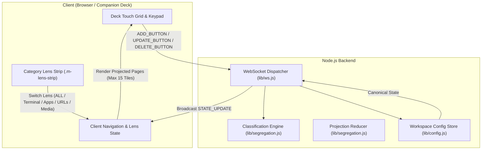

# Workspace Tile Segregation Engine — Technical Design Document

* **Author:** Karthik Kulkarni
* **Date:** 2026-11-08
* **Status:** Approved Architecture (Path A: Non-Destructive Virtual Lens & View Projection)
* **Target Version:** Arya Dock v1.1.0 / Schema v2 Extension

---

## 1. The Problem

Arya Dock transforms mobile phones, tablets, and secondary screens into low-latency macro companion decks for workstations. As developers expand their setups within a workspace (such as the Developer Cockpit), they configure diverse shortcut types:
- Interactive shell scripts and CLI sessions (`terminalMode: 'tab'`, `'window'`, or `'existing'`)
- Native desktop applications (`google-chrome`, `org.gnome.ptyxis`, `code`)
- Browser URLs (API documentation, dashboards, PR trackers)
- System audio and media controls (play/pause, volume, telemetry)

Currently, tiles populate workspace pages in the chronological order of their creation. This leads to three concrete operational limitations:
1. **Unorganized Tool Distribution**: Users must search across multiple pages to locate related controls (e.g., terminal scripts mixed with browser links).
2. **Mixed Task Views**: During focused tasks (such as running terminal diagnostics), pages display unrelated media or browser tiles alongside active tools.
3. **Unstructured Page Overflow**: Arya Dock limits page capacity to **15 tiles (5×3 grid)** to maintain touch target size and legibility on mobile viewports. Adding shortcuts without categorization creates multi-page sprawl without grouping.

---

## 2. Overview

The **Workspace Tile Segregation Engine** is a non-destructive organization system that groups shortcuts into four functional action categories—**Terminal**, **Application**, **URL**, and **Media**—and presents them through dedicated category views within the active workspace.

Following architectural review (Path A: Virtual Lens & View Projection), segregation operates as an **ephemeral presentation layer** over canonical workspace data:
- **Canonical Storage Preserved**: `workspace.pages` remains the durable backing store in `profiles.json`. User-configured layouts and manual page groupings are never destroyed, shredded, or re-indexed on disk.
- **Dynamic 15-Tile Projection**: When a category view or segregation mode is active, the engine filters workspace shortcuts and projects them into virtual sub-pages strictly capped at **15 tiles (5×3)**.
- **O(1) Lossless Reversibility**: Toggling segregation or switching views is instantaneous and mathematically lossless. Because the backing store is never mutated, reversibility is guaranteed with zero data-loss risk.
- **Responsive Dynamic Grid Integrity**: Filtered arrays remain dense, allowing Arya Dock's container query engine (`getOptimalGridDimensions()`) to dynamically scale button dimensions (2×1, 2×2, 3×3, 5×3) for optimal finger touch targets.
- **Multi-Deck Touch Safety**: Category filtering and navigation pointers remain client-scoped session state, ensuring an editor on a workstation never forcibly yanks the screen on connected operator companion decks (tablets/phones).

---

## 3. Goals & Non-Goals

### 3.1 Goals
1. **Deterministic Rule-Based Classification**: Categorize tiles into Terminal, Application, URL, and Media categories using pure evaluation of `actionType`, `terminalMode`, desktop application origin (`isApplication`), desktop command heuristics, and explicit user overrides.
2. **Workspace-Level Opt-In & Lens Switching**: Support both persistent workspace default segregation (`workspace.segregation = { enabled: boolean }`) and on-the-fly client lens filtering (`[ALL] [💻] [🚀] [🌐] [🎵]`).
3. **15-Tile (5×3) Page Invariant**: Enforce the 15-tile limit on all category projected pages, allocating excess category tiles to sequentially numbered virtual sub-pages (`Terminal 1/2`, `Terminal 2/2`).
4. **Touch-Safe Multi-Deck Concurrency**: Maintain independent navigation contexts across client devices; tile editing actions must never disrupt active viewports on remote companion decks.
5. **Zero Storage Destruction**: Eliminate per-tile coordinate ledgers (`originCoordinates`) and sparse slot gaps (`slotIndex`) by projecting dense button arrays on demand.

### 3.2 Non-Goals
1. **Destructive Disk Re-indexing**: Physical page arrays in `profiles.json` will not be shredded into separate category pages on disk.
2. **Cross-Workspace Migration**: Tiles will never be moved outside their parent workspace (e.g. tiles in `developer` will never migrate to `media`).
3. **Nondeterministic AI or Cloud Categorization**: Classification will rely purely on local deterministic metadata without remote API dependencies.
4. **Dynamic User-Defined Categories**: Version 1 restricts categorization to the four core functional categories (Terminal, Application, URL, Media) plus explicit overrides.

---

## 4. Architecture & Technical Plan

### 4.1 System Architecture

The Workspace Tile Segregation Engine is composed of three decoupled components:
1. **Classification Engine (`lib/segregation.js`)**: Pure function mapping button data to canonical categories (`'terminal' | 'application' | 'url' | 'media'`).
2. **View Projection Reducer (`lib/segregation.js`)**: Pure functions that filter and chunk button collections into virtual category pages of up to 15 tiles.
3. **Client Presentation Controller (`public/app.js`)**: Manages active lens selection, pagination paddles within category projections, and settings modal integration.



---

### 4.2 Data Model & Schema Extensions (Schema v2 Extension)

The data model maintains backward compatibility within Schema v2. No schema version bump is required; all additions are optional and whitelisted in [`lib/config.js`](file:///home/karthikulkarni/Documents/arya-dock/lib/config.js).

#### Workspace Schema Extension
```javascript
// Whitelisted in validateWorkspace()
{
  id: "developer",
  name: "Developer Cockpit",
  icon: "code",
  segregation: {
    enabled: true        // boolean; defaults to false if omitted
  },
  pages: [ /* Canonical Page objects */ ]
}
```

#### Button Schema Extension
```javascript
// Whitelisted in validateButton()
{
  id: 0,                    // Non-negative integer (0..14) strictly maintained
  label: "Docker Up",
  actionType: "shell",
  command: "docker compose up -d",
  terminalMode: "background",
  isApplication: false,     // boolean; true if created via desktop app catalog
  categoryOverride: null    // null | 'terminal' | 'application' | 'url' | 'media'
}
```

---

### 4.3 Classification Engine Specification

The classifier is implemented as a pure function `classifyButton(button)` with deterministic precedence:

```javascript
/**
 * Resolves the functional category for a button.
 * @param {Object} button
 * @returns {'terminal' | 'application' | 'url' | 'media'}
 */
function classifyButton(button) {
  // 1. Explicit user override takes precedence (normalized)
  if (button && typeof button.categoryOverride === 'string') {
    const override = button.categoryOverride.trim().toLowerCase();
    if (['terminal', 'application', 'url', 'media'].includes(override)) {
      return override;
    }
  }

  // 2. Dedicated media action
  if (button?.actionType === 'media') {
    return 'media';
  }

  // 3. Web URL action
  if (button?.actionType === 'url') {
    return 'url';
  }

  // 4. Shell / command actions
  if (button?.actionType === 'shell') {
    // Interactive shells targeting tab, window, or existing session are Terminal
    if (['tab', 'window', 'existing'].includes(button.terminalMode)) {
      return 'terminal';
    }
    // Background execution:
    // If flagged as desktop application origin, categorize as Application
    if (button.isApplication === true) {
      return 'application';
    }
    // Heuristic: check if command matches common GUI desktop binaries
    if (isKnownDesktopCommand(button.command)) {
      return 'application';
    }
    return 'terminal';
  }

  // Default fallback
  return 'terminal';
}

/**
 * Heuristic check for common GUI desktop application commands.
 * @param {string} command
 * @returns {boolean}
 */
function isKnownDesktopCommand(command) {
  if (!command || typeof command !== 'string') return false;
  const cmd = command.trim().toLowerCase();
  const knownBinaries = [
    'google-chrome', 'chrome', 'firefox', 'brave', 'chromium',
    'code', 'cursor', 'subl', 'gedit',
    'slack', 'discord', 'telegram-desktop', 'spotify',
    'gimp', 'inkscape', 'vlc', 'obs', 'steam'
  ];
  return knownBinaries.some(b => cmd === b || cmd.startsWith(b + ' '));
}
```

---

### 4.4 View Projection & Virtual Page Allocation

Instead of modifying physical pages on disk, `lib/segregation.js` exports a projection helper that generates virtual pages dynamically:

```javascript
const MAX_BUTTONS_PER_PAGE = 15;

/**
 * Projects a workspace into virtual pages for a target category.
 * @param {Object} workspace
 * @param {'all' | 'terminal' | 'application' | 'url' | 'media'} lens
 * @returns {Array<{ pageNumber: number, name: string, category: string, buttons: Array }>}
 */
function getCategoryProjection(workspace, lens = 'all') {
  if (!workspace || !Array.isArray(workspace.pages)) return [];

  // When 'all' is selected, return canonical workspace pages directly
  if (lens === 'all') {
    return workspace.pages;
  }

  // Gather all buttons across all canonical pages in the workspace
  const allButtons = [];
  workspace.pages.forEach(p => {
    if (Array.isArray(p.buttons)) {
      allButtons.push(...p.buttons);
    }
  });

  // Filter buttons matching the active category lens
  const matchingButtons = allButtons.filter(b => classifyButton(b) === lens);

  // If no buttons match, return a single empty placeholder page
  if (matchingButtons.length === 0) {
    return [{
      pageNumber: 1,
      name: `${formatCategoryName(lens)} 1`,
      category: lens,
      buttons: []
    }];
  }

  // Chunk matching buttons into pages of at most MAX_BUTTONS_PER_PAGE (15)
  const virtualPages = [];
  for (let i = 0; i < matchingButtons.length; i += MAX_BUTTONS_PER_PAGE) {
    const chunk = matchingButtons.slice(i, i + MAX_BUTTONS_PER_PAGE);
    const subPageIndex = Math.floor(i / MAX_BUTTONS_PER_PAGE) + 1;
    virtualPages.push({
      pageNumber: subPageIndex,
      name: `${formatCategoryName(lens)} ${subPageIndex}`,
      category: lens,
      buttons: chunk
    });
  }

  return virtualPages;
}
```

#### Key Invariants of View Projection:
1. **Mathematical Losslessness**: Because `workspace.pages` on disk is never altered, switching lenses or disabling segregation is an O(1) in-memory operation with zero data-loss risk.
2. **Dense Responsive Grids**: Each projected page contains a dense array of buttons. Arya Dock's `getOptimalGridDimensions()` in `public/app.js` sizes buttons optimally to fill mobile touch screens without sparse slot gaps.
3. **Integer Button IDs**: Button IDs remain non-negative integers (`0..14`), eliminating ID collisions and click dispatcher failures.

---

### 4.5 Multi-Deck Concurrency & Viewport Isolation

In Arya Dock's client-server architecture:
- **Global Server State**: Canonical workspaces and active workspace ID (`activeProfileId` / `workspaceId`) are shared across clients.
- **Client Session State**: Active category lens (`activeLens`) and projected page index (`projectedPageIndex`) are maintained **locally in each browser / companion deck session** (`public/app.js`).
- **Touch Safety on Companion Decks**: When an editor on a desktop browser adds or updates a tile, the server broadcasts the updated buttons via `STATE_UPDATE`. Remote companion decks receive updated button data without having their active viewport or page index abruptly changed. Pinned decks (`navState.pinned === true`) remain completely undisturbed.

---

### 4.6 WebSocket Protocol Actions

All state synchronization uses the existing unified `broadcastState()` engine in [`lib/ws.js`](file:///home/karthikulkarni/Documents/arya-dock/lib/ws.js):

| Action | Direction | Payload | Description |
|---|---|---|---|
| `TOGGLE_SEGREGATION` | Client ➔ Server | `{ type: 'TOGGLE_SEGREGATION', workspaceId: string, enabled: boolean }` | Toggles default segregation setting on workspace (requires `ws.canEdit`). |
| `UPDATE_BUTTON` | Client ➔ Server | `{ type: 'UPDATE_BUTTON', buttonId: number, ...updates }` | Updates button fields including `categoryOverride` (requires `ws.canEdit`). |
| `STATE_UPDATE` | Server ➔ Broadcast | `{ type: 'STATE_UPDATE', workspaceId, workspaces, navigation, buttons, ... }` | Broadcasts state; includes `segregation: { enabled: boolean }` in workspace object. |

---

## 5. Alternatives Considered

### 5.1 Destructive Server-Side Physical Page Re-Partitioning (Rejected)
* **Description**: Shredding `workspace.pages` on disk into separate category pages and tracking origin coordinates (`originCoordinates`) for reversibility.
* **Evaluation**:
  - *Cons*: High blast radius; unhandled `TypeError` crashes when restoring workspaces modified while segregated; button ID collisions across merged pages; global navigation hijacking on multi-device setups; collapses responsive grid sizing.
* **Verdict**: **Rejected**. View projection (Path A) achieves identical categorization and capacity benefits with zero storage corruption risk.

### 5.2 Classifying All Background Shell Commands as Applications (Rejected)
* **Description**: Mapping all buttons with `terminalMode: 'background'` directly to "Application".
* **Evaluation**:
  - *Cons*: CLI commands (`git status`, `docker compose up`, `npm test`) are developer tools, not GUI desktop apps.
* **Verdict**: **Rejected**. Background shell commands default to Terminal unless flagged with `isApplication: true` or matching known desktop binary names.

### 5.3 Sparse 15-Slot Grid Preservation with Dummy Keys (Rejected)
* **Description**: Injecting 15-element arrays with dummy or null keys to preserve spatial whitespace.
* **Evaluation**:
  - *Cons*: Degrades mobile touch ergonomics by forcing tiny 40px buttons on phones even when a page has only 2 buttons.
* **Verdict**: **Rejected**. Keep button arrays dense to preserve dynamic fluid grid sizing (`getOptimalGridDimensions()`).

---

## 6. Detailed Implementation Plan

### 6.1 Affected Files & Components

| File | Change Type | Purpose & Scope |
|---|---|---|
| [`lib/config.js`](file:///home/karthikulkarni/Documents/arya-dock/lib/config.js) | Modify | Whitelist `segregation: { enabled: boolean }` in `validateWorkspace()`; whitelist `isApplication` (boolean) and `categoryOverride` (string or null) in `validateButton()`. |
| [`lib/segregation.js`](file:///home/karthikulkarni/Documents/arya-dock/lib/segregation.js) | **Create** | Pure modules: `classifyButton()`, `isKnownDesktopCommand()`, and `getCategoryProjection()`. |
| [`lib/ws.js`](file:///home/karthikulkarni/Documents/arya-dock/lib/ws.js) | Modify | Add `TOGGLE_SEGREGATION` handler (with `ws.canEdit` check); serialize `segregation` in `broadcastState()`; attach `isApplication: true` on app catalog additions. |
| [`public/index.html`](file:///home/karthikulkarni/Documents/arya-dock/public/index.html) | Modify | Add `#workspaceSettingsModal` container & `#btnWorkspaceSettings` button; add `.m-lens-strip` to header tools; add Category dropdown in `#editModal`. |
| [`public/style.css`](file:///home/karthikulkarni/Documents/arya-dock/public/style.css) | Modify | Styling for `.m-lens-strip`, `.m-lens-tab`, `.m-lens-tab.active`, and settings modal elements. |
| [`public/app.js`](file:///home/karthikulkarni/Documents/arya-dock/public/app.js) | Modify | Handle lens switching, category projection rendering, settings modal toggle, and drag-and-drop `isApplication` flag attachment. |
| [`test/segregation.test.js`](file:///home/karthikulkarni/Documents/arya-dock/test/segregation.test.js) | **Create** | Unit tests for classification rules, 15-tile page chunking, and non-destructive projection. |

---

### 6.2 Step-by-Step Implementation Sequence

#### Phase 1: Core Classifier & Projection Engine
1. **Extend Schema Whitelists in [`lib/config.js`](file:///home/karthikulkarni/Documents/arya-dock/lib/config.js)**:
   - In `validateWorkspace()`: whitelist `segregation: { enabled: boolean }`.
   - In `validateButton()`: whitelist `isApplication: boolean` and `categoryOverride: string | null` (sanitizing empty string to `null` and lowercasing).
2. **Implement [`lib/segregation.js`](file:///home/karthikulkarni/Documents/arya-dock/lib/segregation.js)**:
   - `classifyButton(button)`: pure rule-based classifier with desktop command heuristics.
   - `getCategoryProjection(workspace, lens)`: pure projection function chunking matching buttons into dense virtual pages capped at `MAX_BUTTONS_PER_PAGE = 15`.
3. **Author [`test/segregation.test.js`](file:///home/karthikulkarni/Documents/arya-dock/test/segregation.test.js)**:
   - Unit test classifier with all permutations of `actionType`, `terminalMode`, `isApplication`, and overrides.
   - Unit test chunking: verify that 16 terminal tiles produce `Terminal 1` (15 tiles) and `Terminal 2` (1 tile).
   - Verify that canonical `workspace.pages` remains unmutated by projection calls.

#### Phase 2: WebSocket Dispatcher Integration
1. **Extend `broadcastState()` in [`lib/ws.js`](file:///home/karthikulkarni/Documents/arya-dock/lib/ws.js)**:
   - Ensure `segregation: activeWs.segregation || { enabled: false }` is serialized in the `STATE_UPDATE` payload.
2. **Add `TOGGLE_SEGREGATION` Handler in [`lib/ws.js`](file:///home/karthikulkarni/Documents/arya-dock/lib/ws.js)**:
   - Verify `if (!ws.canEdit)`.
   - Toggle `activeWs.segregation = { enabled: Boolean(msg.enabled) }`.
   - Invoke `saveConfig()` and `broadcastState(wss, context)`.
3. **App Catalog Metadata in [`public/app.js`](file:///home/karthikulkarni/Documents/arya-dock/public/app.js)**:
   - Ensure buttons dragged or picked from the App Catalog attach `isApplication: true`.

#### Phase 3: Client UI & Lens Strip
1. **Workspace Settings Modal (`public/index.html`, `public/app.js`)**:
   - Add `#btnWorkspaceSettings` to `.m-header-tools`.
   - Add `#workspaceSettingsModal` markup with `#toggleSegregation` checkbox.
   - Bind click and change handlers; emit `TOGGLE_SEGREGATION`.
2. **Category Lens Strip (`public/index.html`, `public/style.css`, `public/app.js`)**:
   - Add `.m-lens-strip` with tabs: `[ALL]` `[💻 TERMINAL]` `[🚀 APPS]` `[🌐 URLS]` `[🎵 MEDIA]`.
   - On tab click: set `activeLens`, reset projected page index to 0, and re-render grid via `getCategoryProjection()`.
3. **Tile Edit Modal (`public/index.html`, `public/app.js`)**:
   - Add "Category" dropdown: `<option value="">Auto (Default)</option>`, `terminal`, `application`, `url`, `media`.
   - Save selection into `categoryOverride` on `UPDATE_BUTTON`.

#### Phase 4: Automated Verification
1. Run full unit test suite: `npm test`.
2. Run code style and syntax checks: `npm run lint`.
3. Run browser verification flows: `npm run test:reticle`.

---

### 6.3 Risk Assessment & Mitigation

| Risk | Impact | Likelihood | Mitigation Strategy |
|---|---|---|---|
| **Data Loss or Corrupted Configuration** | High | Low | **Zero Risk in Path A**: `workspace.pages` on disk is never modified by view projection. |
| **Multi-Deck Viewport Hijacking** | High | Low | Lens state is purely client-scoped session state; remote companion decks are never forcibly paged. |
| **Touch Ergonomics Degradation** | Medium | Low | Virtual pages remain dense arrays; `getOptimalGridDimensions()` scales buttons dynamically to fill touchscreens. |
| **Classifier Edge Cases** | Low | Medium | Explicit `categoryOverride` dropdown in edit modal empowers users to correct any misclassification immediately. |
