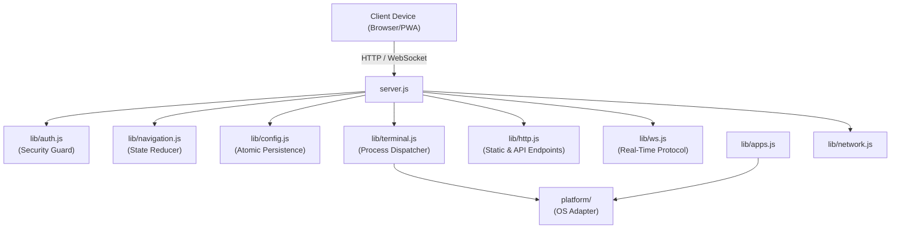

# 📦 `lib/` — Core Backend Services & Domain Architecture

The `lib/` directory contains the core backend services, business logic, security barriers, and state machines powering the Arya Dock workstation companion service.

---

## 📑 Module Manifest

| File | Primary Responsibility | Key Exports |
|---|---|---|
| [`auth.js`](file:///home/karthikulkarni/Documents/arya-dock/lib/auth.js) | Credential generation, constant-time validation, Origin checks, and role resolution | `safeEqual`, `loadOrCreateAuth`, `rotateAuthCredentials`, `isAllowedOrigin`, `isLocalAddress`, `getRole`, `resolvePath`, `getDefaultAuthDir`, `getDefaultAuthPath` |
| [`config.js`](file:///home/karthikulkarni/Documents/arya-dock/lib/config.js) | Schema migrations (v0->v1->v2), atomic writes, backup rotation, auto-recovery, and validation | `CURRENT_SCHEMA_VERSION`, `loadConfig`, `saveConfigAtomic`, `migrateLegacyConfigAndAuth`, `validateButton`, `validateWorkspace`, `getBackups`, `rotateBackups`, `resolveConfigPath`, `resolveWorkingDir` |
| [`terminal.js`](file:///home/karthikulkarni/Documents/arya-dock/lib/terminal.js) | Shell escaping, terminal emulator CLI formatting, background execution, and unreferenced process spawning | `quoteForShell`, `buildActionCommand`, `executeAction`, `getDefaultShell`, `getDefaultTerminal` |
| [`navigation.js`](file:///home/karthikulkarni/Documents/arya-dock/lib/navigation.js) | Pure navigation reducer, workspace app-id normalization, context matching, and pinning state | `createInitialNavigationState`, `normalizeAppId`, `findWorkspaceForApp`, `navigationReducer` |
| [`apps.js`](file:///home/karthikulkarni/Documents/arya-dock/lib/apps.js) | FreeDesktop `.desktop` entry parsing, icon/emoji heuristics, and suggested project directories | `getInstalledApplications`, `getSuggestedProjectDirs`, `getAppEmoji` |
| [`http.js`](file:///home/karthikulkarni/Documents/arya-dock/lib/http.js) | Static PWA asset delivery, path traversal defenses, health checks, and role-gated REST API endpoints | `createHttpHandler`, `MIME_TYPES` |
| [`ws.js`](file:///home/karthikulkarni/Documents/arya-dock/lib/ws.js) | WebSocket connection lifecycle, client handshake, operator vs. editor mutation dispatch, and state broadcasting | `setupWebSocketServer`, `broadcastState` |
| [`network.js`](file:///home/karthikulkarni/Documents/arya-dock/lib/network.js) | Network interface enumeration prioritizing USB tethering interfaces over Wi-Fi and Ethernet | `getNetworkInterfaces` |

---

## 🏛️ Architecture & Component Interactions



---

## 🔒 Architectural Invariants & Guarantees

1. **Constant-Time Cryptographic Comparison**:
   - `safeEqual(a, b)` strictly employs `crypto.timingSafeEqual` over UTF-8 buffers. It returns `false` early if buffer byte lengths mismatch, neutralizing timing side-channel attacks on pairing tokens and editor keys.
2. **Strict File Permissions (`0600`)**:
   - `auth.json` containing `pairingToken` and `editorKey` is written using `{ mode: 0o600 }` and explicitly confirmed via `fs.chmodSync(targetPath, 0o600)` to prevent multi-user system inspection.
3. **Atomic Persistence & Backup Retention**:
   - Configuration files are never directly overwritten. Writes are staged in a hidden temporary file (`.profiles.<timestamp>.<rand>.tmp`) and atomically swapped via `fs.renameSync`.
   - Before swapping, the current configuration is archived to a timestamped backup (`profiles.json.bak.<timestamp>-<counter>`), maintaining the 5 newest snapshots and pruning older ones.
4. **Auto-Recovery from Truncation / Corruption**:
   - If `profiles.json` is truncated or corrupted (e.g. power failure during manual edits), `loadConfig()` inspects historical backups newest-first, quarantines the corrupted file as `profiles.json.corrupted.<timestamp>`, restores the newest valid backup, and resumes startup with zero downtime.
5. **Path Traversal & Metacharacter Sanitization**:
   - `http.js` guards against directory traversal attacks by decoding URIs and rejecting any path containing `..`, `%2e`, or `%2E`.
   - `resolveWorkingDir()` and `resolveConfigPath()` expand `~` and `$HOME` safely while rejecting control characters (`\x00-\x1f\x7f`) and shell metacharacters (`;`, `&`, `|`, `` ` ``, `<`, `>`, `^`, `"`, `'`).
6. **Detached Unreferenced Process Spawning**:
   - User actions dispatched by `terminal.js` spawn child processes with `{ detached: true, stdio: 'ignore' }` and immediately invoke `child.unref()`. This prevents server process blocking and avoids zombie process retention.

---

## ⚡ Recent Epics Implementation

### Epic E0 — Foundation
- Implemented core HTTP request routing in [`http.js`](file:///home/karthikulkarni/Documents/arya-dock/lib/http.js) and WebSocket connection management in [`ws.js`](file:///home/karthikulkarni/Documents/arya-dock/lib/ws.js).
- Constant-time token verification and Origin header matching in [`auth.js`](file:///home/karthikulkarni/Documents/arya-dock/lib/auth.js).

### Epic E1 — Platform Adapters
- Decoupled OS-specific shell, terminal, and media execution from backend services into the `platform/` abstraction layer.
- Modularized audio controller commands and FreeDesktop application scanning directories in [`apps.js`](file:///home/karthikulkarni/Documents/arya-dock/lib/apps.js) and [`terminal.js`](file:///home/karthikulkarni/Documents/arya-dock/lib/terminal.js).

### Epic E2 — Config Relocation & Debounced Persistence
- Relocated user configuration outside the git repository to conform with the XDG Base Directory specification (`~/.config/arya-dock/`).
- Added automated first-boot migration in [`config.js`](file:///home/karthikulkarni/Documents/arya-dock/lib/config.js) (`migrateLegacyConfigAndAuth`).
- Introduced debounced file saves (250ms batching window) and synchronous `SIGINT`/`SIGTERM`/`beforeExit` flushing.

### Epic E3 — Workspace Model v2 & Navigation Reducer
- Added [`navigation.js`](file:///home/karthikulkarni/Documents/arya-dock/lib/navigation.js) implementing pure state transitions (`navigationReducer`) for workspace switching, page cycling, and pinning.
- Added Schema v2 migration (`migrateV1ToV2`) transforming legacy profiles dictionaries into first-class `workspaces` arrays with application match rules (`match.apps`).

---

## 🧪 Verification & Testing

Run the unit and integration test suites covering the `lib/` modules:

```bash
# Run all tests covering lib/
node --test test/auth.test.js test/config.test.js test/terminal.test.js test/navigation.test.js test/http.test.js test/integration.test.js
```
